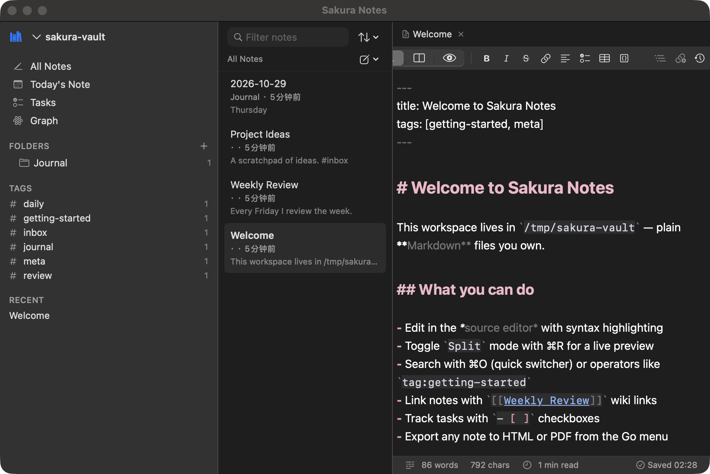
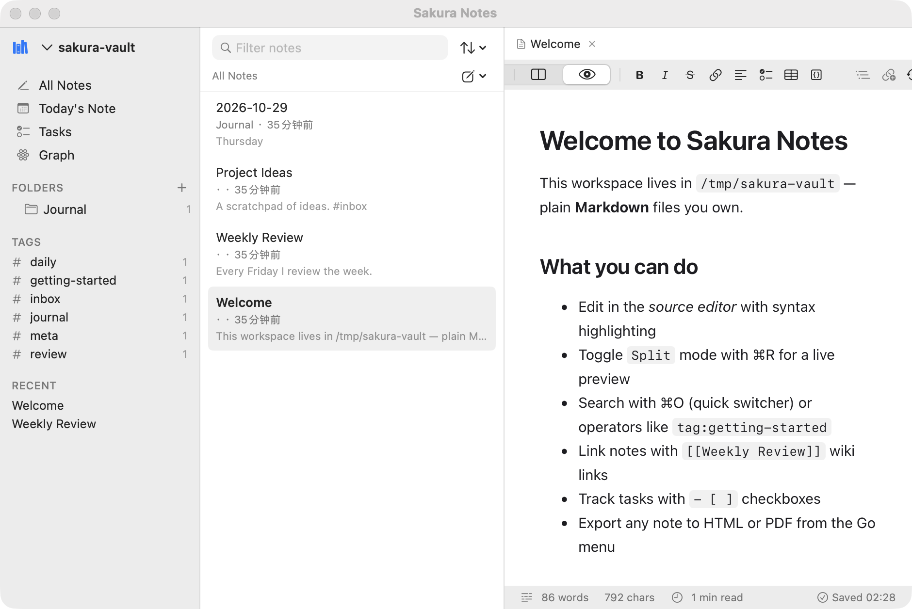
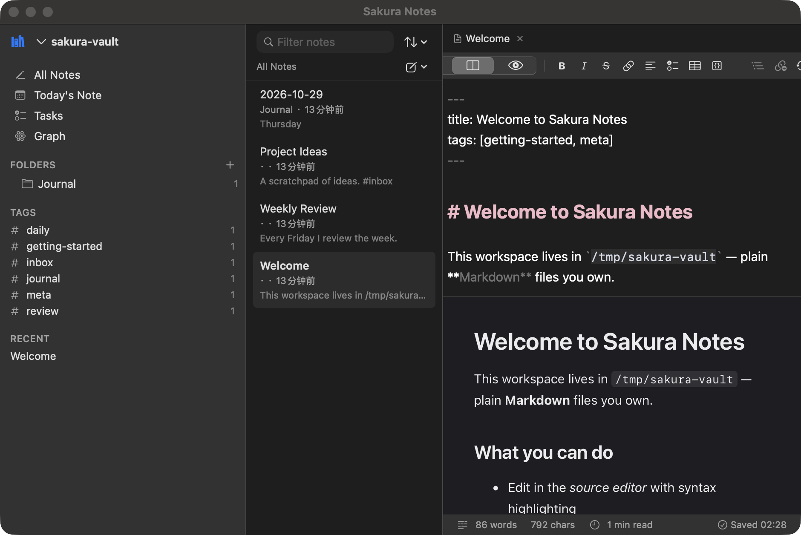
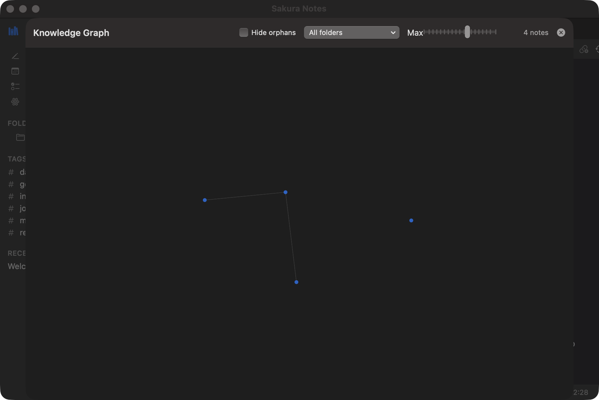

# Sakura Notes

A native macOS Markdown notebook with local-first storage, powerful full-text search, linked notes, and an optional AI writing assistant.

Your notes are ordinary Markdown files in folders you own. Sakura Notes adds a fast native editor, live preview, instant search, wiki links with a knowledge graph, task aggregation, daily notes, templates, version history, and an opt-in AI assistant — without ever taking your files hostage.

**Status: early release (0.x).** The core editing, storage, search, and knowledge features are implemented and tested; see [Known limitations](#known-limitations) for an honest list of what is not finished.

## Design principles

- **Local-first.** Notes are plain `.md` files on disk. Every feature is derived state that can be rebuilt from your files; delete the app and your notes remain.
- **Native.** SwiftUI and AppKit throughout: real windows, real menus, system dark mode, standard keyboard behavior, VoiceOver-accessible controls.
- **Writing-first.** A calm, typography-led interface with a distraction-free editor, adjustable reading width, and no permanent chrome.
- **Predictable.** Atomic writes, trash instead of delete, snapshots before risky overwrites, and explicit conflict resolution when files change outside the app.
- **Private.** No account, no telemetry, no network access except when you run an AI action with your own provider key.

## Features

### Editor
- Source editor with live Markdown syntax highlighting (headings, emphasis, code, links, wiki links, tags, task boxes)
- Live preview and split view with GitHub-style rendering, syntax-highlighted code, tables, task checkboxes, LaTeX math (KaTeX), and Mermaid diagrams — all bundled locally, no CDN
- Automatic list continuation (including ordered-list numbering), tab indentation, task toggling
- Formatting shortcuts: bold, italic, strikethrough, links, wiki links, headings (⌥⌘1–6), code blocks, tables
- Image paste and drag-and-drop into a per-vault attachments folder with relative links
- `[[Wiki link]]` autocomplete with fuzzy matching; ⌘-click to follow
- Adjustable font, size, line spacing, and writing width; spell check; standard find bar
- Autosave with a visible saved/unsaved state; word/character counts and reading time

### Workspace and files
- Multiple workspaces (any folder), quick switcher (⌘O), command palette (⌘P)
- Folder tree, note list with filtering/sorting/excerpts, tags with counts, recents
- Create, rename, move, duplicate notes and folders; everything deletes to the macOS Trash
- External change detection with a compare-and-resolve sheet (keep mine / take theirs / keep both); external edits never silently overwrite local work, and local saves never silently overwrite external ones
- **Internal links follow renames and moves** — wiki links and relative paths are rewritten automatically (each modified note is snapshotted first)

### Search
- SQLite FTS5 index over titles, content, and tags; incremental, cancellable, rebuildable
- Operators: `tag:`, `path:`, `ext:`, `title:`, `before:YYYY-MM-DD`, `after:YYYY-MM-DD`, `-exclusion`, `"exact phrase"`, prefix matching
- Result snippets with highlighted matches; CJK text searched by substring

### Knowledge management
- `[[Wiki links]]` with deterministic resolution (path → title → file name), backlinks, outgoing links, broken-link detection, unlinked mentions
- Knowledge graph with force-directed layout, folder/tag filters, orphan hiding, and a node cap for large vaults
- Task aggregation across the vault with one-click toggling (standard `- [ ]` syntax only)
- Daily notes with configurable folder; templates with `{{title}}`, `{{date}}`, `{{time}}`, `{{date:FORMAT}}` variables
- YAML front matter (scalar keys, block and flow lists) with unknown keys preserved verbatim

### Safety net
- Atomic writes (temp file + fsync + rename) so interrupted saves can't corrupt notes
- Version history as plain files in Application Support: captured before overwrites, conflict resolution, and AI edits; browsable with diffs and one-click restore
- All indexes are derived state and can be rebuilt from your files at any time

### AI assistant (optional, off by default)
- Any OpenAI-compatible endpoint; API keys stored in the macOS Keychain, never in files or logs
- Current-note actions (summarize, proofread, expand, shorten, translate, tone, titles, outlines, keywords, tables, checklists, flashcards, explanations) with a **diff preview and explicit accept/reject** before anything touches your note
- Ask questions across your notes with inline `[[citations]]`, grounded-answer instructions, and a transparent "what will be sent" notice
- Configurable context scope (current note / note + linked notes / all notes) and character budget; note content is only ever sent when you press the button

## Screenshots

| | |
|---|---|
|  |  |
|  |  |

## Requirements

- macOS 14.0 (Sonoma) or later
- Apple Silicon or Intel Mac
- Building from source: Swift 6 toolchain (Xcode 16+ or Command Line Tools)

## Build and run

```bash
git clone https://github.com/yueseqaz/sakura-notes.git
cd sakura-notes
swift run
```

Or build a self-contained `SakuraNotes.app` bundle:

```bash
bash scripts/build_app.sh dist
open dist/SakuraNotes.app
```

The app is not code-signed with a Developer ID certificate and is not notarized (no signing credentials are available in this project). The first launch may require right-click → Open, or `xattr -cr dist/SakuraNotes.app`.

## Testing

```bash
bash scripts/test.sh
```

On Command-Line-Tools-only machines the script loads Swift Testing's macro plugin explicitly; on full Xcode setups plain `swift test` works too. The suite covers markdown analysis and rendering, front matter round-trips, file operations and conflict detection, snapshots, search operators, link resolution, and link rewriting — 73 tests across 14 suites. See [docs/TESTING.md](docs/TESTING.md).

## Storage model and privacy

- **Source of truth:** your chosen folder. Notes are `*.md` / `*.txt`; images and attachments live in the vault's `Attachments/` folder (configurable).
- **Derived state** lives in `~/Library/Application Support/SakuraNotes/` (search index) and `~/Library/Snapshots` under the same root (version history) — both rebuildable/deletable without touching your notes.
- **Per-vault metadata** is a single `.sakuranotes/meta.json` file inside the vault; it is never required to read your notes elsewhere.
- **Network:** the only network traffic is AI requests to the endpoint you configure, when you trigger one. The preview never loads remote resources. See [PRIVACY.md](PRIVACY.md) and [SECURITY.md](SECURITY.md).

## AI configuration

Settings → AI Assistant: add a provider (name, base URL like `https://api.openai.com/v1`, model), paste your API key (stored in the Keychain), and press **Test Connection**. Actions are available from the AI panel, the AI menu, and the command palette. Notes are transmitted only when you run an action or ask a question, and never the whole vault.

## Import and export

- **Import:** File → Import Folder of Notes… copies a folder tree of Markdown into the workspace (source files are never moved or deleted; a report shows created/skipped counts)
- **Export:** Go menu exports the current note as HTML (self-contained, fonts embedded), PDF (A4, WebKit rendering), or Markdown

## Known limitations

Honest list of what is not implemented (yet):

- No full WYSIWYG editing mode — source and live preview modes only
- No end-to-end encryption; notes are only as protected as your filesystem
- No code signing or notarization (no Developer ID credentials in this project)
- No document cloud sync of its own — use iCloud/Dropbox/etc. folders; the app detects and resolves the conflict copies sync services produce, but each provider's semantics are its own
- No plugin system, web clipper, presentation mode, or Spotlight/Shortcuts integration (roadmap)
- No per-note pinning/favorites UI, batch tag editing, side-by-side comparison of two different notes, or tab drag-reordering
- The graph view is read-only (no drag-to-arrange persistence)
- Reminders/due-date notifications are parsed (`@due(YYYY-MM-DD)`) but not surfaced as notifications yet

## Roadmap

The 0.x releases finish the core; larger surface work follows only once what's underneath is stable. Items are grouped by theme — nothing is promised on a date, and the [known limitations](#known-limitations) list is the source this roadmap is worked from.

**Trust and distribution**
- Developer ID signing and notarized release builds (blocked on credentials, not code), then signed automatic updates
- Reproducible, checksum-published release artifacts for every tag

**Editing and organization**
- Batch operations: multi-select in the note list for move/tag/trash
- Per-note pinning and favorites; side-by-side comparison of two notes; tab drag-reordering
- Saved searches; optional sandboxed custom CSS for the rendered preview

**Knowledge**
- Reading mode with progress and a presentation mode built from headings
- Opt-in due-date reminders for `@due(...)` tasks (local notifications only)
- Duplicate and stale-note detection, plus a link-maintenance dashboard for broken links and orphans

**Platform integration**
- Opt-in Spotlight indexing of note titles and paths
- Shortcuts/AppIntents actions (open note, append capture, run AI action)
- A plugin API with an explicit permission model — only after the theming architecture is stable enough to promise extension compatibility

**Engineering**
- Swift 6 strict-concurrency cleanup (the code currently compiles in language mode 5 by design; see docs/ARCHITECTURE.md)
- Incremental FSEvents reconciliation for very large vaults (currently a debounced full rescan + diff)

Have an opinion about what matters next? Open an issue — the roadmap is adjusted by real usage, not by checklist.

## Contributing

See [CONTRIBUTING.md](CONTRIBUTING.md). Short version: Swift 6 toolchain, `bash scripts/test.sh` before you push, keep modules layered (Core → Storage/Search/AI → App), and match the existing restrained design language.

## License

[MIT](LICENSE). Third-party bundled assets: [highlight.js](https://highlightjs.org/) (BSD-3-Clause), [KaTeX](https://katex.org/) (MIT), [Mermaid](https://mermaid.js.org/) (MIT) — see [NOTICE.md](NOTICE.md).
